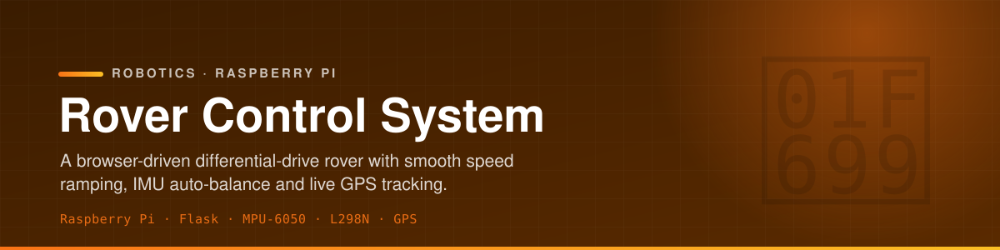
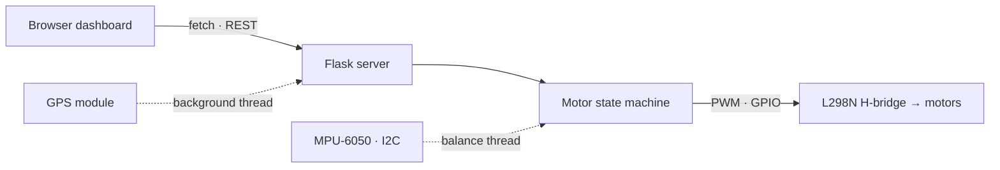

<p align="center">
  
</p>

<p align="center">
  
  
  
  
  
</p>

<p align="center">
  A Raspberry Pi differential-drive rover you drive from a browser. A Flask server serves a live
  control dashboard — any device on the network can steer it, watch IMU tilt, and read GPS<br>
  coordinates in real time, with smooth speed ramping and a toggleable IMU auto-balance mode.
</p>

---

## ✨ What it does

- 🕹️ **Browser control** — a Flask + HTML/JS dashboard sends `fetch()` calls on button press/release
  to REST endpoints (`/forward`, `/backward`, `/left`, `/right`, `/stop`, `/speed`, `/balance`).
- ⚙️ **Differential drive** — an L298N H-bridge with two 1 kHz PWM channels controls left/right
  motor speed independently, tracked by a `FORWARD/BACKWARD/LEFT/RIGHT/STOP` state machine.
- 📈 **Speed ramping** — acceleration and deceleration run in separate threads, stepping PWM duty
  5% every 200 ms; a `threading.Lock` guards the shared speed state.
- ⚖️ **IMU auto-balance** — `Balance.py` reads an MPU-6050 over I2C in a daemon thread and adjusts
  motor output to keep the rover level when enabled.
- 🛰️ **Live GPS** — a background thread streams real-time coordinates to the dashboard.
- 🔧 **Ops scripts** — `start` / `stop` / `restart` / `check` shell scripts manage the server.

## 🏗 Architecture



## 🔌 Hardware

| Component | Detail |
| --------- | ------ |
| Controller | Raspberry Pi |
| Motor driver | L298N dual H-bridge |
| Left motor | IN1 = GPIO 23, IN2 = GPIO 24, ENA = GPIO 12 (PWM) |
| Right motor | IN3 = GPIO 27, IN4 = GPIO 22, ENB = GPIO 13 (PWM) |
| IMU | MPU-6050 (I2C) |
| GPS | UART GPS module |

## 🗂 Project structure

```text
├── final_version_app.py    # Main Flask app (production version)
├── archive/                # Earlier iterations (app.py, state-machine refactor, threading fix)
├── Balance.py / IMU.py     # MPU-6050 balancing + raw IMU reader
├── gps_module.py           # GPS background thread
├── static/                 # script.js (controls) + style.css
├── templates/index.html    # web control interface
└── *.sh                    # start / stop / restart / check scripts
```

## 🚀 Setup & run

```bash
pip install flask RPi.GPIO smbus2     # smbus2 for the MPU-6050; gpsd for GPS

python final_version_app.py
# or: bash start_rover.sh
```

Then open the Pi's address in a browser on the same network and drive.

## 🧰 Stack

| Layer | Tech |
| ----- | ---- |
| Controller | Raspberry Pi, Python 3 |
| Server | Flask (REST endpoints) |
| Frontend | HTML + JavaScript (`fetch`) |
| Motion | L298N H-bridge, GPIO PWM, threaded speed ramping |
| Sensing | MPU-6050 IMU (I2C), UART GPS |
